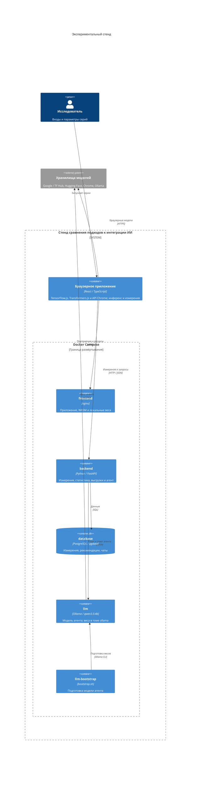

# Архитектура экспериментального стенда

Диаграммы описывают текущую реализацию проекта и хранятся как код Mermaid в нотации C4.

## Контейнеры и связи

Исходный код: [c4-containers.mmd](c4-containers.mmd).

Редактируемая версия для diagrams.net / draw.io: [c4-containers.drawio](c4-containers.drawio).

Контейнер в C4 обозначает приложение или хранилище. Граница Docker Compose отдельно показывает, какие приложения запускаются в Docker. Браузер выполняется на машине исследователя и находится за этой границей.

## Компоненты измерительной части

Исходный код: [c4-components.mmd](c4-components.mmd).

Здесь раскрыта структура браузерного приложения. FastAPI, nginx и встроенные сервисы Chrome показаны как внешние для этого приложения участники.

```mermaid
C4Component
    title Измерительная часть стенда - C4, уровень компонентов браузерного приложения

    Person(researcher, "Исследователь", "Задаёт входные данные и параметры серии")
    Container_Ext(frontend, "frontend", "nginx", "Раздаёт приложение, изображения, WASM и локальные веса")
    Container_Ext(backend, "backend", "FastAPI", "Сохраняет результаты в PostgreSQL; выдаёт записи и выгрузки")
    System_Ext(chrome_ai, "Встроенные ИИ-API Chrome", "Prompt, Summarizer, Rewriter, Writer, Proofreader, Translator, LanguageDetector")
    System_Ext(remote_weights, "Хранилища библиотечных моделей", "Google / TF Hub и Hugging Face")

    Container_Boundary(browser, "Веб-приложение в браузере") {
        Component(ui, "Интерфейс экспериментов", "StandPage, BenchmarkPanel, ModelSelector", "Принимает тексты и изображения, выбирает реализации и параметры")
        Component(registry, "Реестр экспериментов", "benchmark/experiments.ts", "Описывает 14 задач и связывает их с адаптерами")
        Component(runner, "Оркестратор серий", "benchmark/runner.ts", "Последовательно выполняет повторы; при настройке исключает первый вызов")
        Component(metrics, "Измерения и среда", "benchmark/metrics.ts", "performance.now(), изменение JS-кучи, сведения о браузере и устройстве")
        Component(library, "Библиотечный адаптер", "models/tensorflow.ts", "Запускает модели TensorFlow.js и Transformers.js / ONNX Runtime Web")
        Component(builtin, "Адаптер встроенных API", "models/geminiNano.ts", "Создаёт сессии и вызывает встроенные ИИ-функции браузера")
        Component(diagnostics, "Диагностика доступности", "builtinAi.ts, useNanoModel.ts, EnvironmentPanel", "Проверяет API, отслеживает загрузку модели, сохраняет отдельную диагностику")
        Component(api_client, "Клиент измерений", "api/benchmarkApi.ts", "Передаёт серии на сервер и получает сохранённые результаты")
        Component(results, "Просмотр результатов", "MeasurementsPage, ResultsTable", "Показывает записи, сводки, фильтры и ссылки на CSV")
    }

    Rel(researcher, ui, "Настраивает и запускает эксперимент")
    Rel(ui, registry, "Получает описание выбранной задачи")
    Rel(ui, runner, "Передаёт вход и настройки серии")
    Rel(runner, registry, "Вызывает реализацию задачи")
    Rel(registry, library, "Выполняет библиотечный вариант")
    Rel(registry, builtin, "Выполняет встроенный вариант")
    Rel(runner, metrics, "Получает снимок среды в начале серии")
    Rel(library, metrics, "Измеряет время и изменение JS-кучи")
    Rel(builtin, metrics, "Измеряет время и изменение JS-кучи")
    Rel(library, frontend, "Читает локальные веса и WASM", "HTTP")
    Rel(library, remote_weights, "Загружает модели при использовании внешних источников", "HTTPS")
    Rel(builtin, chrome_ai, "Выполняет инференс на устройстве", "JavaScript API")
    Rel(diagnostics, chrome_ai, "Проверяет доступность и подготовку моделей", "JavaScript API")
    Rel(diagnostics, api_client, "При запросе передаёт диагностику builtin_availability")
    Rel(ui, api_client, "Сохраняет результаты завершённой серии")
    Rel(api_client, backend, "POST /api/measurements; GET записи и сводки", "HTTP / JSON")
    Rel(results, api_client, "Запрашивает измерения и статистику")
    Rel(researcher, results, "Проверяет и выгружает результаты")

    UpdateLayoutConfig($c4ShapeInRow="3", $c4BoundaryInRow="1")
```

## Как проходит эксперимент

Исследователь задаёт текст или изображение и параметры серии. Оркестратор вызывает нужные адаптеры, которые выполняют инференс в браузере и снимают метрики. После завершения серии интерфейс отправляет результаты в FastAPI, а сервер сохраняет их в PostgreSQL. Снимок среды собирается в начале серии и прикладывается ко всем её измерениям.

Модель в Ollama обслуживает отдельного агента. Агент читает рекомендации и измерения через инструменты, рассчитывает статистику и строит графики. Он не запускает браузерные эксперименты. Числовые расчёты выполняет код Python; Ollama выбирает инструменты и формирует текстовые объяснения. Исходная таблица рекомендаций хранится в базе и не является результатом автоматической проверки моделей.

Для измерительной части источник воздействия - тестовые тексты и изображения, выбранные в интерфейсе. Метрики снимаются браузерными адаптерами, поэтому генератор HTTP-нагрузки и серверный мониторинг не заменяют эти измерения.

## Соответствие коду

| Элемент | Реализация |
|---|---|
| Развёртывание | `docker-compose.yml`, `frontend/Dockerfile`, `backend/Dockerfile` |
| Карточки и настройки | `frontend/src/pages/StandPage.tsx`, `frontend/src/components/BenchmarkPanel.tsx`, `ModelSelector.tsx` |
| Реестр и оркестрация | `frontend/src/benchmark/experiments.ts`, `runner.ts` |
| Метрики и среда | `frontend/src/benchmark/metrics.ts` |
| Библиотечные модели | `frontend/src/models/tensorflow.ts` |
| Встроенные модели | `frontend/src/models/geminiNano.ts`, `builtinAi.ts`, `useNanoModel.ts` |
| Передача и просмотр измерений | `frontend/src/api/benchmarkApi.ts`, `frontend/src/components/ResultsTable.tsx` |
| API и хранение | `backend/app/api/measurements.py`, `backend/app/db/`, `database/init.sql` |
| Агент и инструменты | `backend/app/agent/`, `backend/app/api/agent.py` |
| Подготовка модели агента | `llm/bootstrap.sh` |
| Проверки | `checks/`, `backend/tests/` |

Для просмотра нужен рендерер Mermaid с поддержкой `C4Container` и `C4Component`, например просмотр Markdown на GitHub или расширение Mermaid в редакторе.
